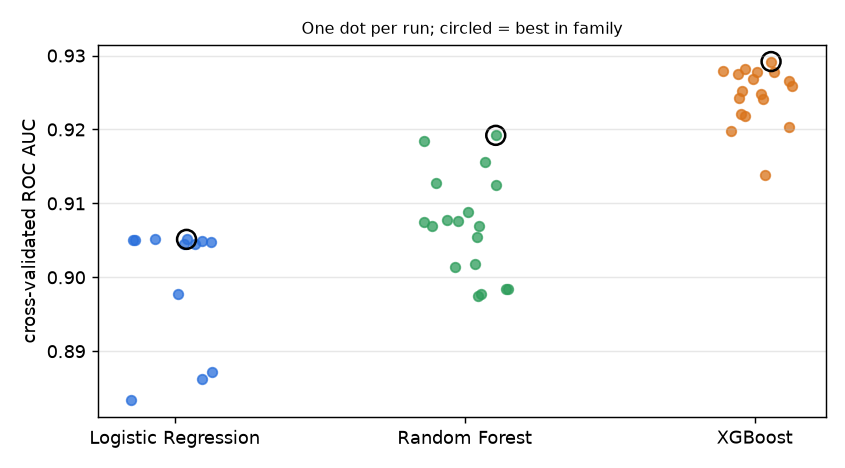
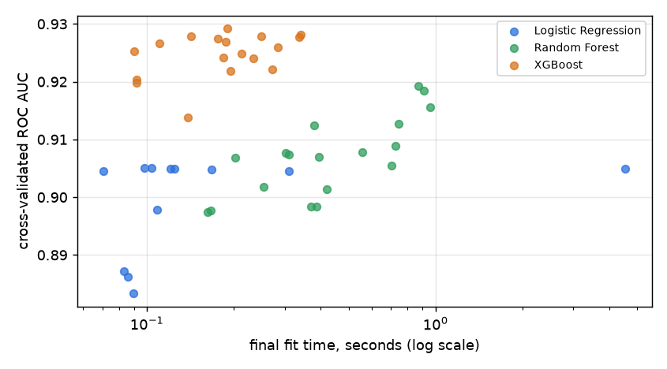

# ML Experiment Tracking Pipeline

Trains and compares Logistic Regression, Random Forest and XGBoost on tabular data and records every run in **MLflow**: parameters, cross-validation and held-out metrics, plots, the fitted model and the data checks it was trained under. A report script then answers the questions a pile of runs is for (which model family wins, by how much, whether the difference is real, which settings mattered), and a gated step promotes the winner to the MLflow Model Registry.

**Stack:** Python · scikit-learn · XGBoost · MLflow · Pandas · NumPy · SciPy · Matplotlib

## What it does

```
adult.data / adult.test ──► clean (Pandas)  ──► validate (33 + 33 checks, then 13 train-vs-test drift checks)
                                                     │  stops here if any check fails
                                                     ▼
 random search: 48 configurations + a baseline ──► one MLflow run each: 5-fold CV on the training file,
                                                     then one evaluation on the held-out file
                                                     ▼
                      MLflow store (SQLite + artifacts) ──► report: leaderboards, paired bootstrap, hyperparameter effects
                                                     ▼
                           registry: best run by CV AUC ──► gate ──► model version + `champion` alias
```

## Results

Dataset: [UCI Adult](https://archive.ics.uci.edu/dataset/2/adult) (census records, predict income above $50K), using its official split. **Training file:** 32,537 rows after removing 24 exact duplicates, 24.1% positive; models are compared by 5-fold stratified cross-validation on it. **Test file:** 16,281 rows, 23.6% positive, scored once per run and never used to choose anything.

**49 runs:** 12 logistic regression, 18 random forest, 18 XGBoost configurations drawn at random from a fixed search space, plus a baseline that predicts the class prior (test ROC AUC 0.500, accuracy 0.764, which is just the share of the majority class). The whole sweep runs in about three minutes on a laptop CPU.

| family | runs | cv_auc_best | cv_auc_median | champion_test_auc | champion_test_f1 | median_train_seconds |
|---|---|---|---|---|---|---|
| XGBoost | 18 | 0.9292 | 0.9256 | 0.9277 | 0.7091 | 0.2 |
| Random Forest | 18 | 0.9192 | 0.9072 | 0.9180 | 0.6991 | 0.4 |
| Logistic Regression | 12 | 0.9051 | 0.9047 | 0.9032 | 0.6720 | 0.1 |

`cv_auc_*` is cross-validated ROC AUC over the family's runs. The champion of each family is the run with the best cross-validated AUC, and `champion_test_*` is what that run scored on the test file afterwards.



What the full [`reports/summary.md`](reports/summary.md) shows, all computed from the tracked runs:

- **XGBoost is the best family**, with the champion at cross-validated AUC 0.9292 (±0.0039 across folds) and test AUC 0.9277. Its settings: `colsample_bytree=0.537`, `learning_rate=0.11627`, `max_depth=8`, `min_child_weight=1`, `n_estimators=200`, `reg_lambda=5.14816`, `subsample=0.869`.
- **The gap to the random forest is small but real on AUC** (+0.010, 95% interval +0.008 to +0.011, paired bootstrap over the same test rows), while on F1 it is not separable from zero (+0.010, interval −0.0004 to +0.021). The gap to logistic regression is clear on both.
- **Cross-validation predicted the test ranking almost perfectly.** Across all 48 model runs, the rank correlation between cross-validated AUC and test AUC is 0.993, and every run's cross-validated and test AUC are within 0.005 of each other. That is the evidence that choosing on CV and reporting on the test file did not leak.
- **Hyperparameters:** tree depth matters for the random forest and `C` (regularisation strength) for logistic regression; both survive a Bonferroni correction for the 11 correlations tested. XGBoost's apparent depth effect (p = 0.044) does not survive it. Number of trees and the sampling rates had no detectable effect at 12 to 18 runs per family.
- **Most configurations land close to their family's best.** The median run is within 0.004 AUC of the best for XGBoost and within 0.001 for logistic regression. The random forest is the exception (median 0.907 against 0.919), because shallow forests do noticeably worse; depth drives that spread.



## What each run records

| | |
|---|---|
| Tags | model family, `config_id` (a hash of the hyperparameters, used to skip finished runs on re-run), git commit, SHA-256 prefixes of the exact train and test data, stage |
| Parameters | every hyperparameter (`hp.*`), seed, number of CV folds, row counts |
| Metrics | cross-validated ROC AUC, F1 and accuracy (mean, standard deviation, **and every fold**, so runs can be compared fold by fold), held-out accuracy, precision, recall, F1, ROC AUC, PR AUC, fit time, prediction time |
| Artifacts | the three data-validation reports, the held-out predictions (`test_proba.npy`, used by the paired tests), a confusion matrix, the 25 strongest features, and the fitted scikit-learn pipeline with its input signature and an example |

All runs use the same seeded folds, which is what makes fold-by-fold and paired comparisons meaningful.

## Data checks

`exptrack/validate.py` runs before any model: expected columns and types, value ranges, allowed category values from the dataset's documentation, missing-value rates, both target classes present, and then train-versus-test checks (population stability index per numeric column, categories in the test file never seen in training, positive-rate gap). The reports are saved with every run. A failed check stops the sweep with the list of failures. On the real data all 79 checks pass.

## Model registry

`python -m exptrack.registry` takes the best non-baseline run by cross-validated AUC and registers its model as `adult-income-classifier` only if it passes a gate: held-out AUC of at least 0.85, cross-validated and held-out AUC within 0.02 of each other, and (if a champion already exists) a cross-validated AUC at least 0.0005 better. The new version gets the `champion` alias and tags linking it to its run and data. Running it again without a better model changes nothing. Currently one version is registered: the XGBoost champion above.

```python
model = mlflow.sklearn.load_model("models:/adult-income-classifier@champion")
```

## Run it

```bash
make venv          # Python 3.12 environment
make data          # downloads adult.data and adult.test from UCI into data/raw
make sweep         # 49 runs, about 3 minutes; safe to interrupt and re-run
make report        # writes reports/summary.md, runs.csv and the plots
make promote       # register the champion
make ui            # MLflow UI at http://localhost:5001
make test
```

On macOS, XGBoost needs the OpenMP runtime. Either `brew install libomp`, or use the copy scikit-learn ships, which the Makefile does for you; for commands run directly:

```bash
export DYLD_FALLBACK_LIBRARY_PATH=$(python -c "import sklearn,os;print(os.path.join(os.path.dirname(sklearn.__file__),'.dylibs'))")
```

(Launching through `nohup` or another system binary drops this variable on macOS. The sweep checks that XGBoost loads before it starts, so this fails immediately rather than halfway.) A smaller sweep: `python -m exptrack.sweep --lr 4 --rf 4 --xgb 4`.

## Tests

`pytest` runs 66 tests in about a minute: the cleaning step on files in the real formats (the test file's junk first line and trailing dots, `?` as missing), every validation check with a deliberately broken input, the sampler (counts, reproducibility, ranges, extending a sweep without redoing runs), a full tracked run against a temporary MLflow store (tags, params, per-fold metrics, artifacts, the saved model reproducing the saved predictions), the report's statistics on hand-made numbers, and the registry gate in each direction. They use a small synthetic frame with Adult's columns, not the real files.

They caught two real bugs while this was written: the experiment was created but never made active, so runs silently landed in MLflow's "Default" experiment, and the report crashed on a family with too few runs for a correlation.

## Limits

- One dataset, and a small, clean, heavily used one. The differences between well-tuned models are small, and nothing here says how the ranking would look on larger or messier data.
- Random search with 12 to 18 draws per family, not an exhaustive or adaptive search. The logistic regression draws happened to include only two runs without class weighting, so its categorical comparisons are thin.
- Cross-validated scores come from five folds of one shuffle; the paired bootstrap resamples test *rows*, so its intervals describe test-set sampling noise, not variation across training sets.
- A seeded random forest repeats to about 1e-5 in AUC, not exactly: threads add up tree predictions in different orders. The logistic regression repeats exactly (both are tested).
- Models are stored with cloudpickle, because MLflow 3's default `skops` format refuses numpy dtypes and XGBoost classes unless every type is allowlisted. Only load models from a tracking store you trust.
- Tracking is a local SQLite file and artifact folder (about 144 MB for 49 runs with models), not a shared server. The registered model is not served or deployed. There is no drift monitoring after training and no data versioning beyond the hash tags.
